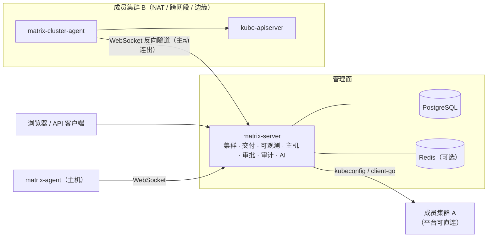

<div align="center">

# 星枢 Matrix

**面向企业私有化场景的多集群 Kubernetes 运维与应用交付平台**


[核心能力](#核心能力) · [架构](#架构) · [集群接入](#集群接入) · [快速开始](#快速开始) · [安全设计](#安全设计) · [文档](#文档) · [路线图](#路线图)

</div>

---

## 简介

星枢 Matrix 把多集群资源管理、应用交付、可观测、主机与堡垒机、中间件和权限审计放在同一个工作台中，供运维与研发工程师日常使用。

平台以 **集群 → 环境 → 命名空间** 组织资源。所有「新建」都使用统一的可视化表单（复杂对象为分步向导，例如工作负载、从代码仓库创建应用、添加堡垒机资产），可以一句话让 AI 填表，也可以切到 YAML 查看和手动编辑，两边实时同步，校验通过后再提交。生产环境的写操作统一走审批、RBAC 和审计。接入 AI 模型后，平台可以根据自然语言生成配置草稿和诊断建议，由工程师确认后再执行。

**设计原则**

- **真实优先**：页面只展示从集群、数据库和外部系统读取到的真实状态，不伪造组件、流量或执行结果。依赖不可用时明确报错，不做降级伪装。
- **统一身份**：每个集群在平台中只有一个身份。资源管理、CI/CD、监控和自动修复都通过同一个集群注册表获取连接。
- **最小打扰**：管理面是一个 Go 服务加 PostgreSQL。成员集群不需要安装平台本体；需要反向接入时，只部署一个轻量 agent。

## 核心能力

| 领域 | 能力 |
| --- | --- |
| **多集群管理** | kubeconfig 直连与 agent 反向隧道两种接入方式；集群改名、健康检查、跨集群资源分发；在 Linux 主机上安装 K3s 集群 |
| **工作负载** | Deployment、StatefulSet、DaemonSet、Job、CronJob、Pod 与自定义资源；`autoscaling/v2` HPA；ConfigMap，以及默认不回显值的 Secret |
| **网络与存储** | Service、Ingress、NetworkPolicy、APISIX 路由；PV、PVC、StorageClass；在已安装快照 API 和驱动的集群上管理 VolumeSnapshot 并从快照恢复 |
| **组件中心** | 发现集群中已安装的组件，区分已安装可读、已安装无权限、未安装和发现失败；按目录安装受支持的组件 |
| **应用交付** | 从代码仓库创建应用（读取分支探测仓库）、凭证管理（Git Token / 账号密码 / SSH 私钥 / 镜像仓库）、流水线可视化与 YAML 双向编排（Kaniko 构建）、发布单与回滚；Helm 仓库与 Chart 目录；对接 Jenkins 和 Argo CD |
| **可观测** | 对接 Prometheus、Loki / Elasticsearch、Jaeger / Tempo 和 Alertmanager；集群总览 24 小时资源曲线；告警定位到资源；通知渠道支持钉钉 / 飞书 / 企业微信（含加签）、邮件、Slack、通用 Webhook（HMAC 签名），保存前可发送测试 |
| **研发中心** | 工作台、需求（评审 → 开发 → 测试 → 验收，按验收标准逐条验收）、迭代与看板、缺陷、测试用例；新建统一表单，支持 AI 填写 |
| **值班与故障** | 分层轮值排班与代班，自动计算当前值班；故障声明后按排班自动指派一线值班，认领 / 处理记录 / 解决全程时间线；SLO 手工或 Prometheus 计算错误预算与燃烧率 |
| **智能运维** | 告警诊断、日志分析、配置草稿生成；修复建议须经权限校验和审批后才能执行 |
| **主机与堡垒机** | 主机 Agent 执行命令和分发文件；堡垒机按「环境 → 资产组」资产树纳管服务器，三步添加资产（资产 → 托管账号 → 授权），真实连通性与登录测试；SSH Web 终端强制录像、命令过滤与终端输出数据脱敏；RDP / VNC 需部署 guacd |
| **中间件** | Kafka、RabbitMQ、RocketMQ、MySQL、PostgreSQL、Redis 实例的接入、概览和控制台 |
| **权限与审计** | 用户、角色、部门与用户组；企业 SSO（OIDC 授权码 + PKCE，可自动建号）；按环境限定可见范围；生产变更走审批；写操作全部记录审计日志 |

## 架构



- **matrix-server**：单个 Go 服务，内含集群、可观测、CI/CD、中间件、堡垒机、自动化和研发中心等模块。模块之间只通过核心接口通信，不直接读取彼此的数据或凭据。
- **matrix-cluster-agent**：运行在成员集群中的单副本 Deployment。它主动连出到平台，平台通过 yamux 多路复用的隧道访问该集群的 kube-apiserver。exec、日志跟随和 watch 都能穿过隧道。
- **多副本**：平台多副本部署时，agent 连接的归属记录在 PostgreSQL 中。其他副本收到请求后，会经过 HMAC 签名的内部转发交给持有连接的副本处理。
## 集群接入

| | kubeconfig 直连 | Agent 接入 |
| --- | --- | --- |
| **网络方向** | 平台主动访问成员集群 API Server | 成员集群主动连出到平台，平台无需入站访问 |
| **平台保存的凭据** | 加密的 kubeconfig | 只保存接入令牌的哈希，没有成员集群凭据 |
| **适用场景** | 同一网络、平台可直接访问 API Server | NAT 之后、跨 VPC、跨机房、边缘集群 |
| **接入步骤** | 上传或粘贴 kubeconfig，测试连接后接入 | 创建集群 → 生成接入清单 → 在成员集群执行 `kubectl apply` |

Agent 接入流程：

1. 在「集群管理 → 接入集群」中选择 **Agent**，填写集群名称和环境。
2. 在生成接入清单时填写平台地址（必须是 HTTPS），按需勾选「同时创建 CI/CD 部署账号」。
3. 在成员集群执行：

   ```bash
   kubectl apply -f matrix-cluster-agent-<集群ID>.yaml
   ```

4. 集群列表显示「agent 已连接」后，节点、工作负载、Helm、CI/CD 和监控巡检都可以使用。

> **安全说明**：接入令牌只显示一次，平台侧只保存它的哈希。agent 首次连接时，平台会绑定该集群 `kube-system` 命名空间的 UID，之后同一个令牌不能被其他集群使用。重新生成清单会立即使旧令牌失效。清单中包含令牌，不要提交到代码仓库。

## 快速开始

### 环境要求

| 组件 | 要求 |
| --- | --- |
| 管理面 | Linux x86_64；Kubernetes、Docker Compose 或 systemd 三种部署方式任选 |
| 数据库 | PostgreSQL（必需），Redis（可选，用于会话和任务协调） |
| 成员集群 | 平台基于 client-go v0.32 构建，已在 Kubernetes 1.29 上验证。使用 Agent 接入时，集群需要能访问平台地址并拉取 agent 镜像 |

### Docker Compose

```bash
cp .env.example .env    # 设置 MATRIX_JWT_SECRET、MATRIX_ENCRYPTION_KEY、POSTGRES_PASSWORD 等
docker compose up -d --build
docker compose ps
```

启动后访问 `http://<服务器地址>:8080`。Compose 会同时启动 PostgreSQL、Redis，以及堡垒机录像和 RDP / VNC 所需的 MinIO、guacd。

### Kubernetes

```bash
docker build --build-arg VERSION=v1.26 -t <镜像仓库>/matrix-server:v1.26 .
docker push <镜像仓库>/matrix-server:v1.26
```

先修改 `deploy/k8s/xingshu-matrix-dev.yaml` 中的镜像地址、`matrix-secrets` 里的密钥和 Ingress 域名，然后执行：

```bash
kubectl apply -f deploy/k8s/xingshu-matrix-dev.yaml
kubectl -n xingshu-system get pods,svc,ingress
```

这份清单自带单实例 PostgreSQL 和 Redis，适合测试环境。生产环境建议改用外部高可用 PostgreSQL。平台多副本部署时，清单已通过 Downward API 注入 `MATRIX_POD_IP`，agent 请求可以在副本之间转发。

### Linux 主机

支持 CentOS、RHEL、Rocky Linux、openEuler、Kylin、Ubuntu 和 Debian：

```bash
sudo bash deploy/baremetal/install.sh --port 8080 --dir /opt/xingshu-matrix
sudo bash deploy/baremetal/uninstall.sh /opt/xingshu-matrix   # 卸载
```

### 首次使用

1. 用 `admin` 和初始密码（`MATRIX_ADMIN_INITIAL_PASSWORD`）登录，系统会要求立即修改密码。
2. 在「系统设置」中填写平台访问地址、镜像源和外部集成参数。
3. 用 kubeconfig 或 Agent 方式接入集群，并选择所属环境。环境决定权限范围和审批策略，接入后不能修改。
4. 配置用户、角色和环境审批策略，再接入镜像仓库、代码仓库和可观测数据源。
5. 在「AI 模型」中添加兼容 OpenAI Chat Completions 接口的模型服务，启用场景化 AI。

## 安全设计

| 方面 | 做法 |
| --- | --- |
| **凭据存储** | kubeconfig、主机密码、中间件密码、Git Token 等敏感信息用 AES-256-GCM 加密后入库。接口只返回掩码，编辑时留空表示保留原值 |
| **写操作审批** | 生产环境写操作必须经过审批；未配置审批策略时直接拒绝，避免绕过审批 |
| **权限范围** | 按用户、角色和环境限定可见资源与可执行操作；后台任务执行前会重新校验申请人的权限 |
| **审计** | 所有写请求自动记录审计日志，涵盖登录、资源变更、审批和自动化操作 |
| **集群接入** | agent 令牌只存哈希，并绑定集群身份；隧道内的每个请求都要校验会话密钥；平台副本之间的转发使用 HMAC 签名，并限制时间窗口 |
| **失败关闭** | AI 模型、权限、控制器、CRD 或集群 API 不可用时，操作明确失败，不伪造成功状态 |

## 仓库结构

| 路径 | 内容 |
| --- | --- |
| `server/cmd/matrix-server` | 平台服务入口 |
| `server/cmd/matrix-agent` | 主机 Agent |
| `server/cmd/matrix-cluster-agent` | 集群 agent（反向隧道） |
| `server/internal/modules` | 业务模块：cluster、cicd、observability、bastion、hosts、middleware、automation、devcenter、provision |
| `server/internal/tunnel` | 集群隧道：WebSocket + yamux，以及多副本转发 |
| `public/` | Web 管理界面 |
| `deploy/` | Kubernetes、Docker、Nginx 与 Linux 部署文件 |
| `docs/` | 平台架构、开发指南与接口文档 |
| `tests/` | 前端、后端与浏览器测试 |

## 开发与构建

```bash
# 后端
cd server && go build ./... && go vet ./... && go test ./...

# 前端
node --test tests/frontend/*.test.mjs

# 平台镜像
docker build --build-arg VERSION=v1.26 --build-arg COMMIT=$(git rev-parse --short HEAD) \
  -t xingshu/matrix-server:v1.26 .

# 集群 agent 镜像（接入清单默认引用与平台版本相同 tag 的 agent 镜像）
docker build -f Dockerfile.cluster-agent --build-arg VERSION=v1.26 \
  -t xingshu/matrix-cluster-agent:v1.26 .
```

版本规则：应用版本采用 `vMAJOR.MINOR`，通过 `--build-arg VERSION` 写入二进制，并由 `GET /api/v1/version` 返回；部署镜像的 tag 可以按发布流程单独编号。

## 文档

| 文档 | 说明 |
| --- | --- |
| [平台技术说明](docs/PLATFORM.md) | 架构、组件边界、数据来源与运维能力 |
| [后端架构](docs/backend-architecture.md) | 模块划分与核心接口 |
| [开发指南](docs/dev-guide.md) | 新增模块、迁移、权限与审批的接入方式 |
| [接口文档](docs/api/) | 按模块划分的 REST API（含 [值班与故障](docs/api/oncall.md)、[堡垒机](docs/api/bastion.md)、[CI/CD](docs/api/cicd.md)、[核心与 SSO](docs/api/core.md)） |
| [对标清单](docs/benchmark-kubesphere-rainbond.md) | 各模块对照 KubeSphere / Rainbond / JumpServer 的整改状态 |
| [v1.26 回归结果](docs/qa/regression-v1.26.json) | 发布前全路由浏览器回归记录 |
| [可观测数据范围](docs/observability-data-scope.md) | 数据源归属与多集群隔离规则 |
| [更新日志](CHANGELOG.md) | 各版本变更 |

## 路线图

- [x] 多集群 kubeconfig 直连与 agent 反向隧道接入
- [x] CI/CD 执行集群统一引用集群注册表
- [ ] 集群采集器套件：日志、指标、链路由各集群内的采集器推送到中心存储，按 `cluster_id` 隔离
- [ ] 采集器与中心存储的一键部署和自动生成数据源
- [ ] Helm 仓库认证、OCI 仓库与任意 Chart 直接安装
- [ ] 从源码创建时自动识别语言并生成构建配置（Rainbond 式）
- [ ] 堡垒机数据库代理、命令审批工单、账号改密计划
- [ ] 平台自助找回密码（系统邮件）

## 致谢

多集群接入与管理的设计参考了 [Rancher](https://github.com/rancher/rancher)、[KubeSphere](https://github.com/kubesphere/kubesphere) 和 [Rainbond](https://github.com/goodrain/rainbond) 的公开架构。

## License

私有仓库，版权所有 © 星枢 Matrix。
