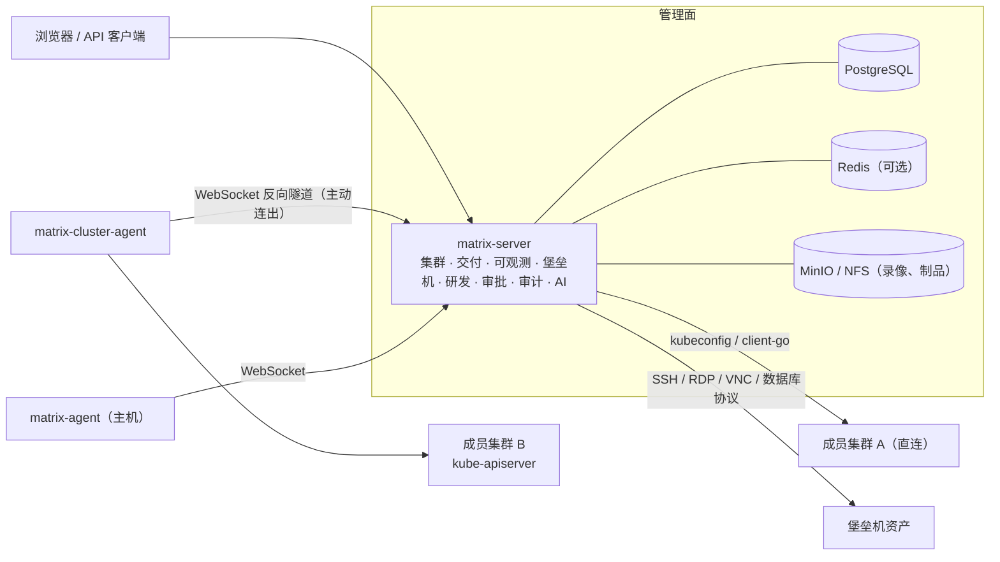

<div align="center">

# 星枢 Matrix

**企业级云原生研发运维一体化平台**


[产品概述](#产品概述) · [产品优势](#产品优势) · [功能全景](#功能全景) · [技术架构](#技术架构) · [部署指南](#部署指南) · [安全体系](#安全体系) · [文档](#文档)

</div>

---

## 产品概述

星枢 Matrix 是面向企业私有化场景的一站式研发运维平台。它以多集群 Kubernetes 管理为底座，把**应用交付、可观测与告警、值班与故障、主机与堡垒机、中间件、研发协作、权限与审计**统一到一个工作台中，让研发、运维、测试与安全团队在同一套身份、同一套资源模型和同一套审批规则下协同工作。

平台以「**环境 → 集群 → 命名空间 → 应用**」组织资源：环境决定权限范围与审批策略，集群提供算力，应用串联代码、构建、发布与运行态。所有写操作都经过 RBAC 校验、按环境审批并记录审计；所有状态都直接读取自集群、数据库与外部系统，所见即真实。

## 产品优势

**一个平台，覆盖交付全链路**
从需求、迭代、缺陷，到代码仓库、流水线构建、发布与回滚，再到监控告警、值班响应与故障复盘，数据在同一平台内流转，无需在多个系统之间来回切换与对账。

**多集群统一纳管，网络零侵入**
支持 kubeconfig 直连与 Agent 反向隧道两种接入方式。Agent 由成员集群主动连出，平台无需入站访问，适用于 NAT、跨 VPC、跨机房与边缘集群；平台侧不保存成员集群凭据。

**生产变更可控、可审计、可追溯**
按环境配置审批策略，生产环境的资源变更、发布、命令执行与高危删除统一走审批流；未配置策略时默认拒绝。写操作、终端会话与录像全程留痕，满足等保与内控审计要求。

**轻量部署，开箱即用**
管理面为单个 Go 服务加 PostgreSQL，支持 Kubernetes、Docker Compose 与 Linux 主机三种部署方式；数据库迁移自动执行，多副本部署开箱即支持，成员集群无需安装平台本体。

**统一的操作体验**
所有「新建」使用同一套可视化表单：复杂对象采用分步向导，可一键切换 YAML 双向编辑，也可用自然语言让 AI 生成草稿，校验通过后再提交。界面全中文，贴合国内企业使用习惯。

**AI 辅助运维，人工把关**
接入兼容 OpenAI 接口的大模型后，平台可进行告警诊断、日志分析、配置生成与自然语言转命令；所有 AI 产出均为草稿，执行前须经过权限校验与人工确认，敏感字段不会发送给模型。

**开放集成**
原生对接 Prometheus、Alertmanager、Loki、Elasticsearch、Jaeger、Tempo、Jenkins、Argo CD、Helm 仓库、Harbor 等主流组件；通知覆盖钉钉、飞书、企业微信、邮件、Slack 与签名 Webhook；企业身份支持 OIDC 单点登录与 LDAP。

## 功能全景

| 领域 | 主要能力 |
| --- | --- |
| **多集群管理** | 直连与 Agent 两种接入；集群健康检查与总览；节点管理（封锁、驱逐、标签、污点、批量操作）；在 Linux 主机上一键安装 K3s 集群；Web kubectl 终端（变更命令走审批） |
| **工作负载** | Deployment、StatefulSet、DaemonSet、Job、CronJob、Pod 与自定义资源；分步创建向导；扩缩容、重启、版本回滚；HPA 与定时伸缩；ConfigMap 与 Secret |
| **网络与存储** | Service、Ingress、NetworkPolicy、网关路由；PV、PVC、StorageClass、卷快照与恢复；证书管理 |
| **项目与配额** | 命名空间项目化管理，ResourceQuota 与 LimitRange；系统命名空间保护，删除需输入名称确认 |
| **组件中心** | 自动发现集群已安装组件；按目录预检并在线安装；Helm 仓库、Chart 目录与 Release 查看 |
| **应用交付** | 从代码仓库创建应用（自动识别语言与构建方式）；凭证管理；流水线可视化与 YAML 双向编排；Kaniko 无特权构建与编译缓存；发布单、审批与回滚；对接 Jenkins、Argo CD |
| **可观测** | 指标、日志、链路数据源统一接入；集群与工作负载监控面板；告警规则与告警事件；告警定位到资源 |
| **通知中心** | 钉钉、飞书、企业微信、邮件、Slack、Webhook；消息模板与订阅规则；按级别、环境、事件类型路由；发送记录与失败重发；外发地址白名单 |
| **值班与故障** | 分层轮值排班与代班；故障声明后自动指派值班人；认领、处理记录、升级与解决全程时间线；SLO 与错误预算 |
| **主机与自动化** | 主机 Agent 执行命令与分发文件；Ansible 剧本与自动化工作流 |
| **堡垒机** | 资产树（环境 → 资产组）、托管账号与授权；SSH Web 终端、RDP / VNC；数据库资产与 Web SQL 控制台；命令过滤、命令审批与访问审批；会话录像回放与强制断开；数据脱敏；账号改密计划 |
| **中间件** | Kafka、RabbitMQ、RocketMQ、MySQL、PostgreSQL、Redis 的接入、概览与控制台 |
| **研发中心** | 工作台、需求全流程（评审 → 开发 → 测试 → 验收）、迭代与看板、缺陷、测试用例、代码仓库、统计报表、AI 辅助开发 |
| **权限与审计** | 用户、角色、部门与用户组；OIDC 单点登录与 LDAP；按环境限定数据范围；审批流；会话管理；完整审计日志 |
| **平台设置** | 平台名称与品牌、系统邮件与自助找回密码、密码与登录安全策略、AI 模型管理 |

## 技术架构



| 组件 | 说明 |
| --- | --- |
| **matrix-server** | 平台服务，Go 实现，按领域划分为集群、CI/CD、可观测、堡垒机、主机、中间件、自动化、研发中心等模块；模块间只通过核心接口交互，凭据互不可见 |
| **PostgreSQL** | 元数据、权限、审计与后台任务队列；各模块独立维护版本化迁移，启动时自动执行并加锁 |
| **matrix-cluster-agent** | 部署在成员集群中，主动连出并通过多路复用隧道代理 kube-apiserver 访问，支持 exec、日志跟随与 watch |
| **matrix-agent** | 部署在 Linux 主机上，负责心跳、主机信息上报、命令执行与文件分发 |
| **多副本** | 平台可水平扩展；集群隧道归属登记在数据库中，副本间通过 HMAC 签名的内部转发访问；后台任务通过数据库锁保证只执行一次 |

## 部署指南

### 环境要求

| 项 | 要求 |
| --- | --- |
| 管理面 | Linux x86_64 / arm64，最低 2 核 4 GB，推荐 4 核 8 GB |
| 数据库 | PostgreSQL 13 及以上（必需）；Redis 6 及以上（可选） |
| 存储 | 堡垒机录像需要 S3 兼容对象存储或共享 NFS（单副本可使用本地卷） |
| 成员集群 | Kubernetes 1.26 及以上；Agent 接入时成员集群需能访问平台地址并拉取 Agent 镜像 |

### 方式一：Kubernetes（推荐）

```bash
# 1. 构建并推送镜像
docker build --build-arg VERSION=v1.28 -t <镜像仓库>/matrix-server:v1.28 .
docker push <镜像仓库>/matrix-server:v1.28

# 2. 修改 deploy/k8s/xingshu-matrix-dev.yaml 中的镜像地址、matrix-secrets 密钥与 Ingress 域名
kubectl apply -f deploy/k8s/xingshu-matrix-dev.yaml
kubectl -n xingshu-system get pods,svc,ingress
```

- 清单包含命名空间、密钥、单实例 PostgreSQL 与 Redis、两副本平台服务、Service 与 Ingress，可直接用于测试与预发环境。
- 生产环境建议删除清单中的 PostgreSQL，将 `MATRIX_DB_DSN` 指向外部高可用 PostgreSQL；平台副本数不少于 2。
- 堡垒机录像的共享存储参考 `deploy/k8s/bastion-storage.yaml`，Istio 网关接入参考 `deploy/k8s/istio-gateway.yaml`。

### 方式二：Docker Compose

```bash
cp .env.example .env      # 设置 MATRIX_JWT_SECRET、MATRIX_ENCRYPTION_KEY、POSTGRES_PASSWORD 等
docker compose up -d --build
docker compose ps
```

访问 `http://<服务器地址>:8080`。Compose 会同时启动 PostgreSQL、Redis，以及堡垒机所需的 MinIO 与 guacd。

### 方式三：Linux 主机

支持 CentOS、RHEL、Rocky Linux、openEuler、麒麟、Ubuntu 与 Debian：

```bash
sudo bash deploy/baremetal/install.sh --port 8080 --dir /opt/xingshu-matrix
sudo bash deploy/baremetal/uninstall.sh /opt/xingshu-matrix   # 卸载
```

### 关键配置

| 环境变量 | 说明 |
| --- | --- |
| `MATRIX_DB_DSN` | PostgreSQL 连接串（必填） |
| `MATRIX_JWT_SECRET` | 会话签名密钥，至少 32 个字符的随机值（必填） |
| `MATRIX_ENCRYPTION_KEY` | 敏感数据加密主密钥，32 字节，base64 或 hex 编码（必填，务必妥善备份） |
| `MATRIX_ADMIN_INITIAL_PASSWORD` | 初始管理员密码，首次登录后强制修改 |
| `MATRIX_REDIS_ADDR` | Redis 地址（可选） |
| `MATRIX_GUACD_ADDR` | guacd 地址，启用 RDP / VNC 时需要 |

完整配置项见 `server/config.example.yaml`。

### 首次使用

1. 使用 `admin` 与初始密码登录，按提示修改密码。
2. 在「系统设置」中填写平台访问地址、系统邮件、登录安全策略，按需配置单点登录。
3. 在「集群管理」中通过 kubeconfig 或 Agent 接入集群，并指定所属环境。
4. 配置角色、用户与环境审批策略。
5. 接入代码仓库、镜像仓库、可观测数据源与通知渠道；在「AI 模型」中接入大模型以启用智能能力。

### 集群接入

| | kubeconfig 直连 | Agent 接入 |
| --- | --- | --- |
| 网络方向 | 平台访问成员集群 API Server | 成员集群主动连出到平台 |
| 平台保存的凭据 | 加密存储的 kubeconfig | 仅接入令牌哈希 |
| 适用场景 | 同一网络 | NAT、跨 VPC、跨机房、边缘 |
| 接入方式 | 上传 kubeconfig 并测试连接 | 生成接入清单后在成员集群 `kubectl apply` |

接入令牌只显示一次，首次连接后与成员集群身份绑定，不能被其他集群复用；重新生成清单会使旧令牌立即失效。

## 安全体系

| 方面 | 措施 |
| --- | --- |
| **身份认证** | 本地账号与 OIDC 单点登录、LDAP；密码复杂度、有效期与登录失败锁定；会话列表与远程吊销；刷新令牌重放检测 |
| **权限控制** | 基于角色的细粒度权限（资源 + 动作），按环境限定可见范围；后台任务执行前重新校验申请人权限 |
| **变更审批** | 按环境配置审批策略，生产写操作与高危命令强制审批；未配置策略时默认拒绝 |
| **凭据保护** | kubeconfig、主机与数据库密码、Git 令牌等以 AES-256-GCM 加密存储，接口只返回掩码；堡垒机托管账号对使用者不可见 |
| **会话审计** | 写操作全量审计；堡垒机会话强制录像、命令记录与实时监控；终端输出数据脱敏 |
| **通信安全** | Agent 隧道会话密钥校验；副本间转发 HMAC 签名并限制时间窗口；通知外发地址白名单 |
| **失败关闭** | 权限、审批、模型或集群 API 不可用时操作明确失败，不伪造成功 |

## 开发与构建

```bash
# 后端
cd server && go build ./... && go vet ./... && go test ./...

# 前端
node --test tests/frontend/*.test.mjs

# 平台镜像
docker build --build-arg VERSION=v1.28 --build-arg COMMIT=$(git rev-parse --short HEAD) \
  -t xingshu/matrix-server:v1.28 .

# 集群 Agent 镜像
docker build -f Dockerfile.cluster-agent --build-arg VERSION=v1.28 \
  -t xingshu/matrix-cluster-agent:v1.28 .
```

版本号采用 `vMAJOR.MINOR`，构建时写入二进制，可通过 `GET /api/v1/version` 查询。

| 路径 | 内容 |
| --- | --- |
| `server/cmd/` | 平台服务、主机 Agent、集群 Agent 入口 |
| `server/internal/modules/` | 业务模块 |
| `server/internal/tunnel/` | 集群隧道与多副本转发 |
| `public/` | Web 管理界面 |
| `deploy/` | Kubernetes、Docker、Nginx 与 Linux 部署文件 |
| `docs/` | 架构、开发规范与接口文档 |
| `tests/` | 前端、后端与浏览器测试 |

## 文档

| 文档 | 说明 |
| --- | --- |
| [平台技术说明](docs/PLATFORM.md) | 架构、组件边界与运维能力 |
| [后端架构](docs/backend-architecture.md) | 模块划分与核心接口 |
| [开发指南](docs/dev-guide.md) · [编码规范](docs/dev-guidelines.md) | 新增模块、迁移、权限与审批的接入方式，以及代码规范 |
| [接口文档](docs/api/) | 按模块划分的 REST API |
| [更新日志](CHANGELOG.md) | 各版本变更 |

## License

私有仓库，版权所有 © 星枢 Matrix。
